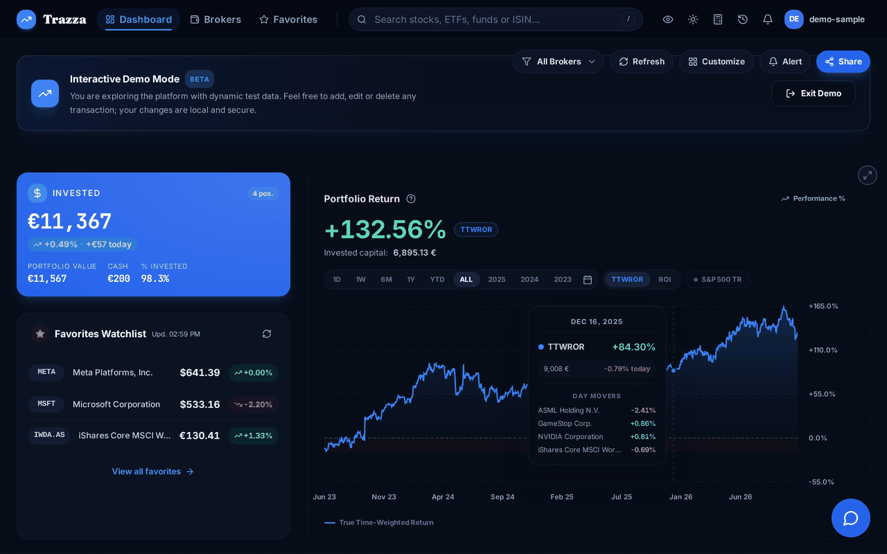
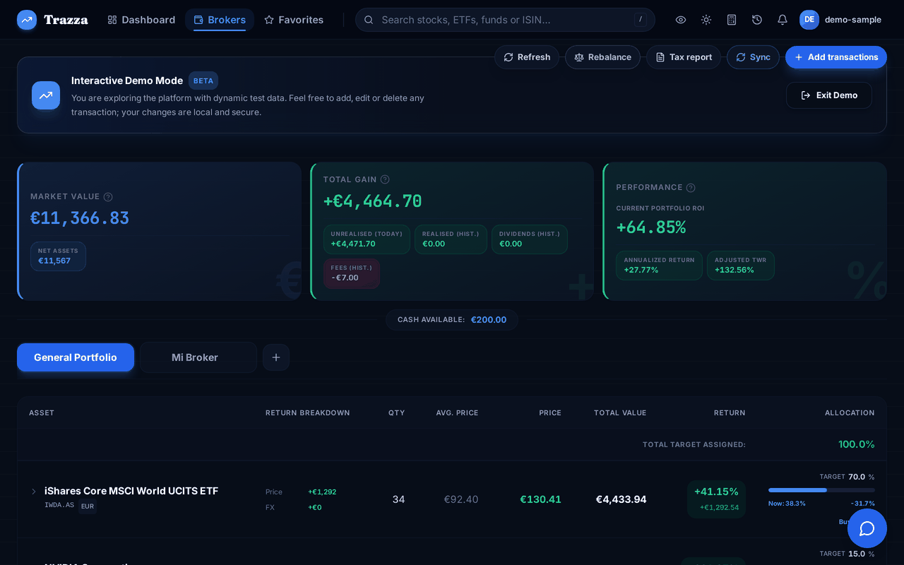
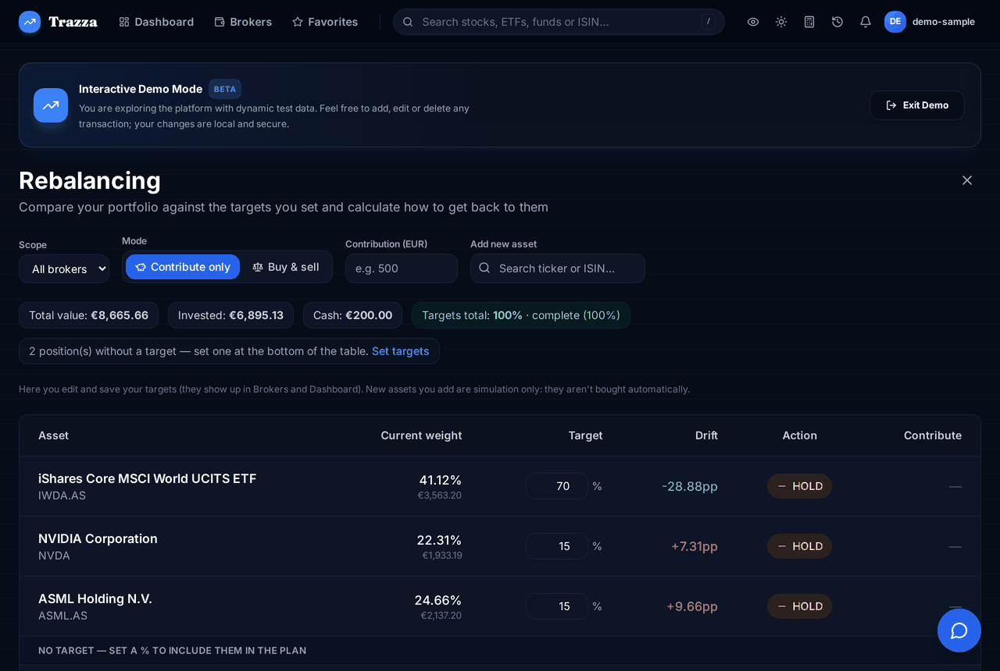
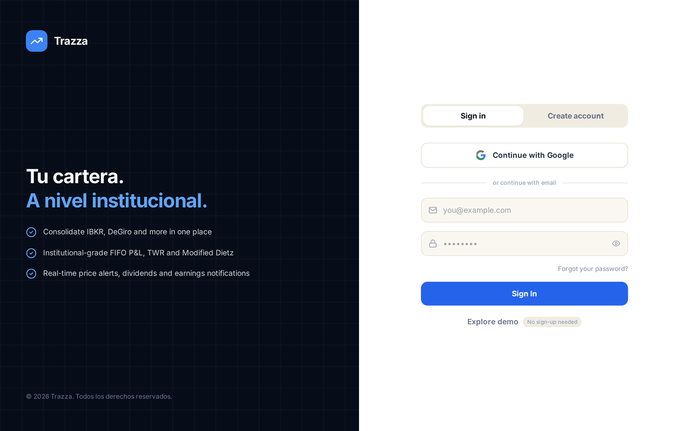
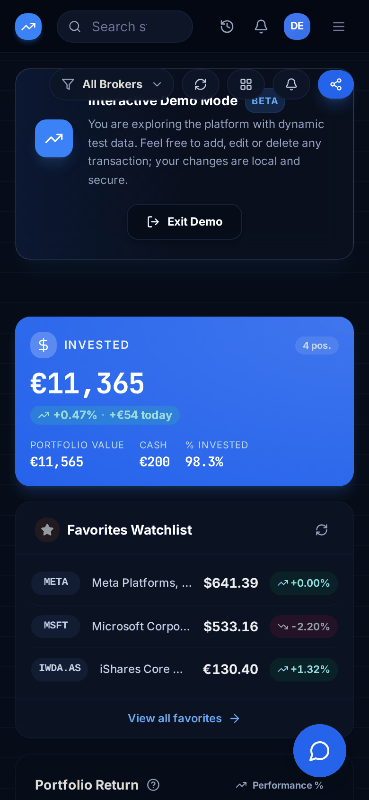
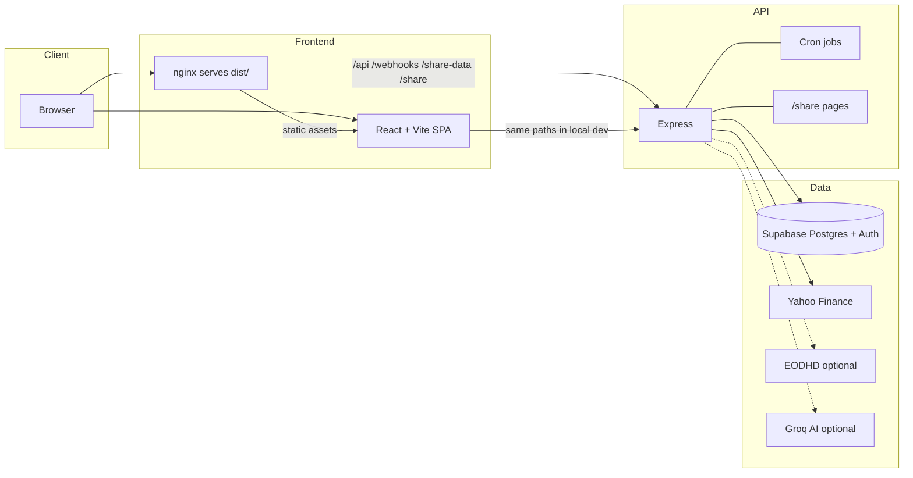
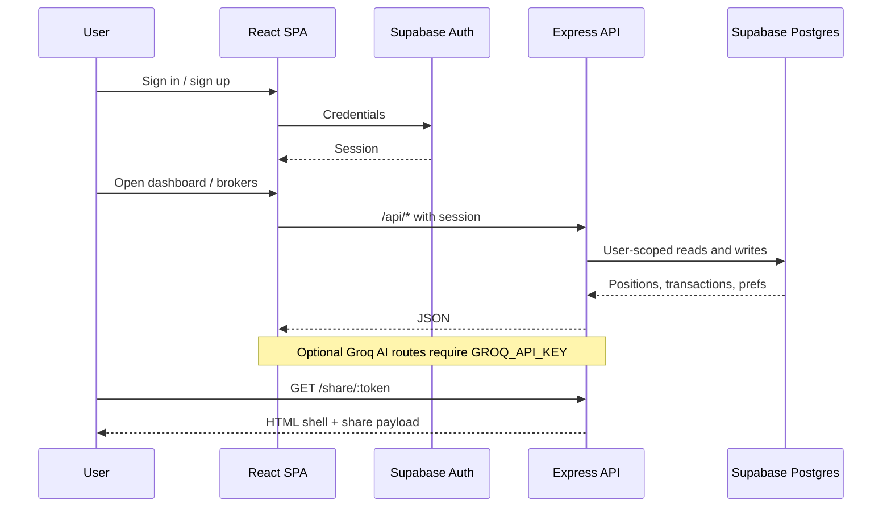

<div align="center">


# Trazza

**Open-source portfolio tracking for multi-broker investors.**

[](./LICENSE)
[](https://react.dev)
[](https://vitejs.dev)
[](https://supabase.com)
[](https://nodejs.org)

</div>

## What is Trazza?

Trazza is a self-hostable app for tracking investment portfolios across brokers. Import transactions from CSV, value positions with live market data, and review performance with the same core metrics throughout the product: time-weighted return (TWR), FIFO cost basis, and Modified Dietz.

This repository is the **OSS carve-out** (the portfolio app + the Gastos/expenses module). It does not ship the private monorepo’s marketing site, blog, Stripe billing, or production ops docs.

Gastos is a **universal opt-in**: any authenticated user with a non-empty email can enable it in Settings (`user_preferences.expenses_enabled`). User-facing notes: [docs/gastos.md](./docs/gastos.md).

Screenshots below were taken in **Interactive Demo Mode** with built-in sample data (no real accounts).

<p align="center">
  
</p>

## Features

- 📥 **CSV import** — DeGiro, IBKR, Binance, and more, with a preview and deduplication before you save
- 🏦 **Multi-broker positions** — cash reconciliation, broker tabs, and a shared positions table
- 📊 **Performance** — TWR, FIFO P&L, and Modified Dietz, including dashboard charts
- 🔗 **Shared portfolio links** — public `/share/:token` pages served by the API
- ⭐ **Dashboard, watchlists, alerts, and favorites**
- ⚖️ **Rebalancing** — compare current weights to targets and plan contributions or trades
- 🧪 **Backtests**
- 📡 **Market data** — Yahoo Finance by default, optional EODHD
- 🤖 **Optional AI** — Groq-powered import validation, portfolio chat, and scoring, with env-based quotas
- 👤 **Admin tools** — user list, import health, and manual snapshots (no paid plans)
- 💸 **Gastos (expenses and savings)** — universal opt-in per user; see [docs/gastos.md](./docs/gastos.md)
- 🧮 **Public calculators and broker guides** — compound interest, dividends, FIRE, capital gains, and broker tax tools

<p align="center">
  
  <br>
  
</p>

<p align="center">
  
  &nbsp;
  
</p>

## How it works

The browser loads a React single-page app (Vite). In Docker, **nginx** serves the built `dist/` bundle and reverse-proxies API paths to **Express**. Express owns `/api/*`, `/webhooks/*`, `/share-data/*`, and `/share/:token`. Portfolio data and authentication live in **Supabase** (Postgres + Auth). Market quotes come from Yahoo Finance (and optionally EODHD). If `GROQ_API_KEY` is set, Express also fronts the optional AI routes. Background jobs (notifications, portfolio snapshots, the weekly report) run inside the API process unless `DISABLE_CRONS=1`.



### Auth and request flow

Sign-up and sign-in go through **Supabase Auth**. The SPA then calls Express with the user session; Express reads and writes portfolio data under the user’s scope (and uses the service role only for server-side work). Shared links are rendered by Express from the built frontend HTML plus that portfolio’s public payload.

An optional **demo mode** (`VITE_DEMO_EMAIL` / `VITE_DEMO_PASSWORD`, or Explore demo) stays in the browser with mock sample data and does not call Supabase.



## Tech stack

| Layer | Stack |
|---|---|
| App UI | React 18, Vite, Tailwind CSS, React Router, TanStack Query, Recharts, i18next |
| API | Express on Node.js ≥ 22 |
| Data & auth | Supabase (Postgres + Auth). Cloud (tested) or Compose `self-hosted` (experimental) |
| Market data | Yahoo Finance (primary), optional EODHD |
| AI (optional) | Groq (`GROQ_API_KEY`); quotas via `AI_*` env vars |
| Email (optional) | Resend or SMTP; unconfigured routes return 503 |
| Runtime | Docker Compose (`cloud` or `self-hosted`) with nginx in front of Express |
| Tests | Vitest, `npm run test:pg` (Postgres), Playwright smokes |

## Quick start

### Prerequisites

- Node.js ≥ 22
- A Supabase project ([cloud](https://supabase.com) or [self-hosted Docker](./docs/self-hosting.md))

### Local development

```bash
cp .env.example .env
# Fill VITE_SUPABASE_URL, VITE_SUPABASE_ANON_KEY, SUPABASE_SERVICE_ROLE_KEY

npm ci
cd server && npm ci && cd ..

# Terminal 1 — API (default :4000)
cd server && node index.js

# Terminal 2 — frontend (:3000)
VITE_VALIDATION_SERVER_URL=http://localhost:4000 npm run dev
```

**Dotenv:** the Express server loads `server/.env` first, then the repo root `.env` (`server/loadEnv.js`). Vite reads `VITE_*` from the environment when you start `npm run dev` / `npm run build` (typically via root `.env`).

To try the UI with built-in sample data, set `VITE_DEMO_EMAIL` and `VITE_DEMO_PASSWORD` and sign in with those credentials (leave them empty to disable credential demo login). Explore demo on the sign-in page uses the public sample set and needs no account.

### Docker (recommended for production-like runs)

> **Tested path:** `docker compose --profile cloud up --build` is the profile verified in CI and for local production-like runs. The **`self-hosted` profile is EXPERIMENTAL and UNTESTED** — use it only if you accept breakage and missing features; details in [docs/self-hosting.md](./docs/self-hosting.md).

**Supabase Cloud** — external project, app + nginx only (tested):

```bash
cp .env.example .env
docker compose --profile cloud up --build
# UI → http://localhost:8080  API health → app container GET /health
```

**Self-hosted Supabase (EXPERIMENTAL, UNTESTED)** — adds Postgres, GoTrue, PostgREST, Kong, and migrations:

```bash
# See docs/self-hosting.md for JWT_SECRET, keys, and first admin
docker compose --profile self-hosted up --build
```

### Static assets vs API

- **nginx (`web` service)** serves the Vite `dist/` output on port **80** (mapped to `HTTP_PORT`, default **8080**).
- **Express (`app` service)** listens on **`PORT`** (default **4000**). It exposes **`GET /health`** and all `/api/*`, `/webhooks/*`, and `/share-data/*` routes. It does **not** serve `dist/`; nginx proxies those paths to the app.
- **`WEB_STATIC_ROOT`:** set to the real webroot that serves the built front (Compose uses `/app/dist`). `/share` fails if the HTML is not found there. Default: `/srv/www/<host>`. Details: [docs/self-hosting.md](./docs/self-hosting.md).

## Project layout

```text
src/          React SPA (pages, components, hooks, services)
server/       Express API, jobs, and routes
supabase/     Schema baseline and migrations
docker/       Compose images, nginx templates, migrate helper
docs/         Self-hosting guide and README screenshots
e2e/          Playwright smoke scripts
tools/        Build, SEO, tests, and the OSS export script
```

## Admin and AI limits (OSS model)

There is **no paid tier**, **no `plan` column** in the database, and **no** global stats route such as **`/api/admin/stats`**. Access control is server configuration only.

1. **`ADMIN_EMAILS`** (recommended): comma-separated list in `server/.env`. Only Supabase accounts with a verified email match.
2. **Fallback:** if `ADMIN_EMAILS` is empty, the **first registered and verified user** becomes admin (stored in `server_app_config`). The server logs a warning on startup.

Admins get unlimited AI quota and access to `/app/admin` (users, import health, manual snapshots, and similar tools). There is **no** API to change a “plan” or fetch global admin statistics.

AI routes require `GROQ_API_KEY` on the server; without it they return **503**. With a key, limits come from environment variables (the UI loads them via `GET /api/ai/limits`):

| Variable | Purpose |
|---|---|
| `AI_DAILY_LIMIT_USER` / `AI_MONTHLY_LIMIT_USER` | Default cap across all AI features |
| `AI_DAILY_LIMIT_CHAT`, `AI_DAILY_LIMIT_ANALYSIS`, `AI_DAILY_LIMIT_IMPORT` | Per-feature daily overrides |
| `AI_MONTHLY_LIMIT_CHAT`, … | Per-feature monthly overrides |

Code defaults when unset: chat 100/500, analysis 30/100, import 50/200 (day/month).

Without `RESEND_API_KEY` or SMTP (`EMAIL_HOST`, …), contact and notification email paths return **503** (`email_not_configured`).

## Tests

```bash
npm run lint
npm test          # Vitest
npm run test:pg   # Postgres / RLS tests (needs a local Postgres; see tools/run-pg-tests.mjs)
```

Full CI also runs `npm run build` and the Playwright smokes (`npm run test:e2e`, `test:e2e:dashboard`, `test:e2e:onboarding`). See `supabase/README.md` for baseline + migration order.

## Contributing

Issues and pull requests are welcome. Please keep changes focused, don’t invent product behavior that isn’t in the tree, and run `npm run lint` and `npm test` before you open a PR. For self-hosting questions, start from [docs/self-hosting.md](./docs/self-hosting.md).

## License

Released under the [MIT License](./LICENSE). Copyright (c) 2026 Trazza.

`package.json` keeps `"private": true` so this workspace is not accidentally published to npm as the upstream product name; the OSS release on GitHub is still MIT.

## Security

See [SECURITY.md](./SECURITY.md). Self-hosting hardening and backups: [docs/self-hosting.md](./docs/self-hosting.md).
